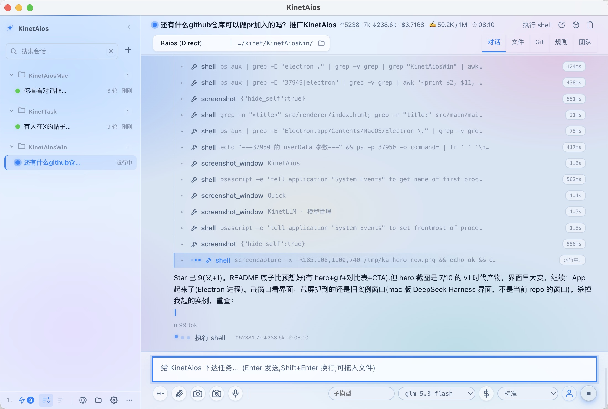
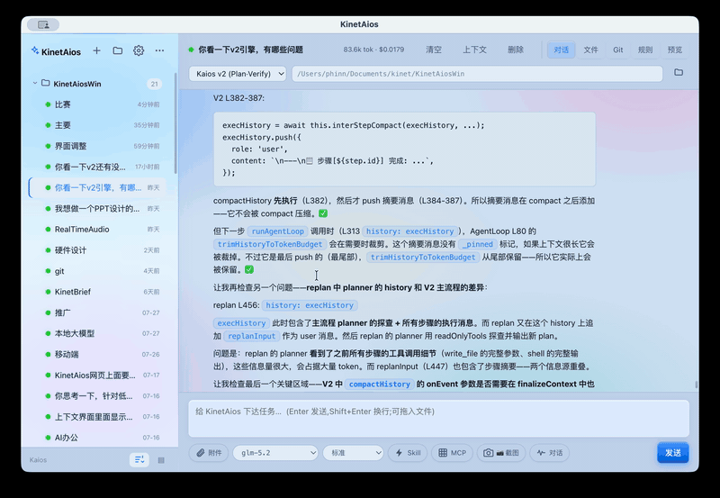

# KinetAios

<!-- SEO: GitHub 搜索关键词覆盖 -->
<!--
AI agent 仪表盘 | 本地优先 AI | 多引擎 Agent | Claude Code 界面 | Codex 界面 |
ReAct 循环 | AI 编程助手 | MCP 客户端 | Electron AI | TypeScript Agent |
Ollama 桌面端 | AMD Radeon AI | 离线 AI Agent | 开源 AI Agent | AI 工作台 |
OrcaRouter | orcarouter provider | orcarouter 预设 | LLM 网关
-->

[English](README.md) | 简体中文

> 🔌 **已接入 [OrcaRouter](https://www.orcarouter.ai)** —— 内置 provider 预设(OpenAI 兼容网关,200+ 模型,自适应路由)。provider 配置(base URL `https://api.orcarouter.ai/v1`、模型 `orcarouter/auto`)见[集成文档](docs/orcarouter.md)。

[](LICENSE)
[](https://github.com/phinn/KinetAios)
[](https://github.com/phinn/KinetAios/releases/latest)
[](https://github.com/phinn/KinetAios/discussions)
[](https://github.com/phinn/KinetAios/issues?q=is%3Aissue+is%3Aopen+label%3A%22good+first+issue%22)
[](https://apps.apple.com/cn/app/id6809450051)

> 🌐 **[官网 / Website → https://phinn.github.io/KinetAios/](https://phinn.github.io/KinetAios/)**

<p align="center">
  
</p>



*真实会话截图:多项目并行会话、每会话独立引擎徽章、文件 / Git / 规则多 tab、逐轮 token 成本统计。*

本地 AI agent 仪表盘,**跨平台 —— Windows 11 和 macOS 都是一等公民**("Win"目录名是历史遗留,仓库即 phinn/KinetAios)。平台差异行为(shell 用 cmd.exe 还是 /bin/sh、热键、托盘)运行时按平台路由,功能两侧对齐。并发跑多个会话、流式答案、shell/文件/搜索/MCP 工具、SQLite 历史 + 长期记忆、全局热键、每会话独立模型。**无需账号,无需中继服务器 —— 你的 LLM API key 就是唯一凭证。**

**30 秒版本:**

- 🔀 **一个窗口七个引擎** —— Direct V1–V5(自研 ReAct 线)+ Claude Code + Codex,每会话可切,Pipeline 跨引擎交接上下文
- 🧠 **本地 SQLite 长期记忆** —— 自动提取用户事实,所有引擎共享,重启不丢
- 🔒 **本地优先,无需账号** —— API key 是唯一凭证,不经过任何中继
- 🛠 **30+ 内置工具 + MCP 客户端/服务端 + 插件** —— shell、文件、网页、截图、Computer Use 开箱即用
- ⌨️ **全局热键快速面板** —— AI agent 版 Spotlight,任何界面一键呼出
- 📊 **真实业务基准测试** —— 40 万行 CRM 交叉分析,自研引擎 **9.2 分** vs Claude Code **7.0 分**([完整报告](documents/excel-cross-analysis-engines.html))
- 🖥 **Windows 11 & macOS 双平台一等公民**

> ⭐ 如果 KinetAios 帮你省了时间,**给个 Star** 就是对独立开源项目最响亮的感谢。

---

## 为什么选 KinetAios?

大多数 AI 客户端把你锁定在一个 provider 上,切引擎就丢上下文,对话还要走中继服务器。KinetAios **一个窗口跑七个引擎**,跨引擎长期记忆,**无需账号**。

|  | KinetAios | Claude Desktop | Cherry Studio | Cursor | Codex Desktop |
|---|---|---|---|---|---|
| 七引擎切换(Direct V1–V5 + Claude Code + Codex) | ✅ | — | — | — | — |
| 本地 SQLite + 自动长期记忆 | ✅ | — | — | — | — |
| 跨引擎记忆(一个用户画像,所有引擎共享) | ✅ | — | — | — | — |
| 多并行会话 | ✅ | — | ✅ | — | ✅ |
| 全局热键 + 快速面板 | ✅ | — | — | — | — |
| 自动扫描 MCP / Skills / Agents | ✅ | ✅ | — | — | — |
| 项目规则(AGENTS / CLAUDE / KINET) | ✅ | — | — | ✅ | ✅ |
| 内置 MCP Server(远程 agent 控制) | ✅ | — | — | — | — |
| 插件系统(工具 / 面板 / slash 命令) | ✅ | — | — | — | — |
| 多模态(图片输入 + 语音 + 截图) | ✅ | ✅ | — | — | — |
| 会话分支 + 跨引擎 Pipeline 编排 | ✅ | — | — | — | — |
| 本地优先,无需账号 | ✅ | ✅ | ✅ | — | — |

## 安装

下载最新发布:

- **Windows** — [下载 `KinetAios-Setup-<版本号>.exe`](https://github.com/phinn/KinetAios/releases/latest)(NSIS 安装包,当前 4.2.0;安装 → 启动 → 填 API key 即用)
- **macOS** — [下载最新 `.dmg`](https://github.com/phinn/KinetAios/releases/latest)(拖进 Applications,同样三步);或 [Mac App Store 版](https://apps.apple.com/cn/app/id6809450051)(¥68,自动更新;本仓库源码构建版永久免费)

> 未签名构建 → Windows SmartScreen / macOS Gatekeeper 会警告,手动放行。

> ⚠️ **v2.9.0 userData 目录迁移** — 从 v2.9.0 起,Windows 的 userData 目录从 `%APPDATA%/kinetaios-win` 改为 `%APPDATA%/KinetAios`。新安装会自动使用新路径。**如果退回 2.9.0 之前的旧版本**,旧版会找不到数据(会话、设置全部消失)。解决办法:将 `%APPDATA%/KinetAios` 重命名为 `%APPData%/kinetaios-win` 即可恢复。

**首次启动**:点右上角 ⚙ → 填 **API Key**(+ Base URL / 模型,默认 GLM 智谱)→ 「测试连接」通了再发任务。

> 🐋 **想一个 key 用遍所有模型?** 选 **OrcaRouter** 预设 —— OpenAI 兼容网关,200+ 模型、自适应路由、零加价。通过[这个链接](https://www.orcarouter.ai/ref/ref_1ed8570b7192ed54082b)注册可支持本项目(5% 推荐额度)。

OrcaRouter provider 配置(内置预设 `orcarouter`):

```yaml
provider: orcarouter          # 设置 → 预设 → OrcaRouter (多模型路由)
protocol: openai              # OpenAI 兼容
base_url: https://api.orcarouter.ai/v1
api_key: sk-orca-...          # 在 OrcaRouter 控制台创建
model: orcarouter/auto        # 自适应路由;也可指定 vendor/model,如 anthropic/claude-opus-4.8
```

### 从源码跑

需要 **Node.js 18+** 和联网(native 模块 `better-sqlite3` 要编译)。

```sh
git clone https://github.com/phinn/KinetAios.git
cd KinetAios
npm install      # 含 postinstall:为 Electron 重编 better-sqlite3
npm run build
npm start
```

> 国内网络 `npm install` 拉 Electron 二进制可能超时 —— `.npmrc` 已配 npmmirror 镜像,失败时也可手动 `ELECTRON_MIRROR=https://npmmirror.com/mirrors/electron/ node node_modules/electron/install.js`。

---

## 功能

### 七个内置引擎(每会话可切,切换清跨引擎上下文)
- **Direct V1(Kaios)**:内置 ReAct 循环 + GLM/OpenAI 兼容 & Anthropic **双向 SSE 流式** Provider,带工具级并发、子 agent、上下文压缩与重试。
 - **Direct V2**:下一代 ReAct,Plan-Execute-Verify-Judge 四层架构,流式工具调用,分步任务清单(聊天流实时渲染为清单卡);计划执行与重规划共用统一执行循环(重试/验证/checkpoint/压缩两条路径行为一致)。
- **Direct V3**:最新,**意图路由器(intent router)** 按查询自动选 `fast` / `standard` / `deep` 三档执行路径,`deep` 路径把工具调用按依赖关系构建为 **DAG 并行执行**(同层只读节点受限并发,写节点串行防竞态),多步任务有真实加速。**deep 任务可后台执行**(3.8+):提交 JobManager 后会话立即解锁,期间实时显示运行数与成本,完成自动回贴;DAG 每节点完成即落 checkpoint,**断点续跑**——任务终止/失败/重启后从断点继续,不再整图作废。引擎选择指南见 [wiki](https://github.com/phinn/KinetAios/wiki/Choose-Engine)。
- **Direct V4(Legis 立法者)**:立法式流水线——把计划编译成显式"法案"步骤(`legis-compiler`),在规则约束下执行(`legis-executor`),落定前用断言验证(`assertions`)。
- **Direct V5(Phylum 种群进化)**:种群进化循环——候选方案运行、打分(`scorer`),优胜策略沉淀进 replay signature 注册表,跨运行自我改进的引擎。
- **Claude Code** *(插件开关)*:spawn `claude -p --output-format stream-json`,解析 NDJSON,`--resume` 续接。
- **Codex** *(插件开关)*:spawn `codex exec --json`,解析 JSONL,`resume` 续接。
- **DeepSeek Harness** *(3.0+,插件引擎)*:spawn `dsh` CLI,一次性执行任务并返回最终回答。和其他引擎一样可按会话切换。

### Direct 工具(30+)
`shell`(执行前确认;**焦点守卫** —— 命令若抢走前台,执行完自动还给原 app)、`read_file`、`write_file`、`edit_file`(精确替换)、`grep`(递归搜内容)、`glob`(列文件)、`web_fetch`(SSRF 防护 + Jina Reader 回退)、`web_search`(Bing → DuckDuckGo 回退)、`recall_memory`、`git_diff`(只读、免确认)、`remember_fact` / `recall_fact`(会话锚点)、`memory_replace` / `memory_append`(核心记忆块)、`dispatch_agent`(只读子 agent —— 独立上下文)、`spawn_team` / `team_broadcast` / `team_send` / `team_close`(多 agent 团队)、`video_gen`(MiniMax H3 文生视频)、`feishu_send_file` / `wecom_send_file`(发文件到飞书/企微会话)、`todo_write`(共享任务清单,聊天流实时渲染为清单卡)。

### Computer Use(系统原生,无外部依赖)
- `screenshot`(支持 `hide_self` —— 截图瞬间自身窗口透明化,零抢焦点)、`screenshot_window`(按标题截任意窗口 —— 被遮挡/后台窗口也能拍,桌面零切换)。
- `mouse_click` / `mouse_scroll` / `mouse_drag`、`keyboard_type` / `keyboard_key` —— 坐标自动从「最后一次截图」的像素空间换算到平台动作空间(DPI / 窗口原点感知,带时效过期)。
- 底层:Electron desktopCapturer + PowerShell(Windows)/ cliclick(macOS)/ xdotool(Linux)。macOS 下裸 `open` 命令被机械重写为 `open -gj` —— agent 永不抢占你的前台。

### MCP 集成(客户端 + 服务端)
- **客户端**:Direct 引擎自动接入系统配置的 MCP 服务(扫描 `~/.claude.json` / `~/.codex/config.toml` / Claude Desktop),stdio 客户端,意外断开自动重连。🔌 按钮可查看已连服务/工具。
- **服务端**:内置 MCP Server(HTTP+SSE)暴露 `run_agent` 工具 —— 远程机器可以调用本机完整 Agent。Token 鉴权(恒定时间比较)、5 分钟超时、僵尸连接检测。

## 工具列表

| 工具 | 说明 |
|---|---|
| `run_agent` | 运行本机完整 Agent(任意引擎)执行任务;流式推进并返回最终答案。Bearer token 鉴权,5 分钟超时。 |

## 配置示例

```json
{
  "mcpServers": {
    "kinetaios": {
      "url": "http://127.0.0.1:18109/mcp",
      "headers": { "Authorization": "Bearer <your-token>" }
    }
  }
}
```

在 KinetAios **设置 → MCP Server** 中启用(自选端口,可选设置 token —— 为空则省略该 header)。默认端口 `18109`,默认关闭。

### 长期记忆 + 记忆图谱
- 每轮后台抽取「关于用户的持久事实」→ SQLite → 注入下轮。**跨引擎、跨会话**共享。
- **记忆图谱**可视化:力导向图展示记忆溯源、冲突检测、时间线。独立全屏窗口。
- 记忆导入/导出 JSON(备份或迁移)。

### Skills / Commands / Agents / 插件
- 扫描 Claude Code 的 skills + commands + agents 和 Codex 的 skills。`/` 菜单或 ⚡ 按钮调用。**内置 skill 随 app 分发**(3.7.3+,首发的 `data-analysis` 移植了 V3 分析工作法:先摸 schema 再下结论、计算交给工具不心算、中间产物落盘、结论可溯源)。
- **技能面板**(设置 → 技能):聚合三方来源 + 内置(只读)+ 插件贡献的全部技能,搜索、查看、直接编辑源文件(插件/内置技能只读),保存即时生效。
- **模型配置档弹窗编辑**(3.7.3+):模型 tab「添加模型」,新增/编辑统一居中弹窗(配置名/key/URL/模型/协议/reasoning/价格/余额查询),内置测试连接。
- **插件 SDK v3**:插件可贡献工具、slash 命令、hooks、全屏面板和**引擎**。按需注入(keywords 关键词匹配省 ~60% token)。**26 个内置插件**:office-suite、brainstorm(Excalidraw)、math-practice、cpp-learning、low-altitude(无人机),arduino-dev / platformio-dev / serial-comm / modbus-dev / mqtt-dev / ble-dev / ota-dev / sensor-lookup / logic-analyzer / hw-diag(嵌入式 & IoT 全家桶)、nestjs-dev、deepseek-harness、gemini-cli、claude-code-router、claude-code、codex、marketing-kit(营销调研:竞品/SEO/漏斗/App 差评挖掘 + 营销控制台面板)等。

### 侧边栏按钮(从左到右)
- **＋** 新建会话。
- **📂 工作台(Workbench)** —— 按 cwd 分组的项目卡片,每张显示近期活动 + 成本。「背景」按钮编辑 `KINET-CONTEXT.md`。
- **会话实时状态** —— 运行中的会话在侧栏标题下方实时显示引擎当前步骤(工具执行 / 重试 / 压缩),不点进去也能掌握进度。
- **📊 仪表盘(Dashboard)** —— 独立窗口,实时 token 用量、成本统计、引擎分布。
- **🌐 文件(Files)** —— 文件浏览 + `<webview>` 预览(HTML/SVG/PNG/JPG/PDF)+ 编辑器。多标签页。地址栏支持 `file://` / `http(s)://` / `localhost:<port>`。
- **🏘️ Town** —— 游戏风格等距可视化,展示网络中的远程节点(其他 KinetAios 实例)。
- **🧠 长期记忆(Memory)** —— 记忆面板:当前频道 / 全部,行内编辑/删除,溯源显示。
- **🔌 插件** —— 插件管理:启用/禁用、搜索过滤、分类卡片。
- **⚙️ 设置** —— 见下。

### 主窗口 Tab(对话 / 文件 / Git / 规则)
- **对话** —— 聊天界面,流式输出、工具步骤折叠、实时 token 计数、上下文检查器、截图、语音输入。
- **文件** —— 与 🌐 同一套,跟随当前会话 cwd。
- **Git** —— `git status`(左)+ `git log`(右)。点改动文件 → 左右对比 diff;点提交 → 统一格式 `git show`。
- **规则** —— 编辑 cwd 的 `KinetAios.md`(项目级规则,注入 system prompt)。

### Pipeline(跨引擎编排)
串联多个 stage,每个指定引擎 + prompt。上一 stage 的输出自动拼到下一 stage 的 prompt 前面。2 分钟/stage 超时轮询,失败中止。

### 会话分支与交接
- **分支(Branch)**:从任意 turn 分叉 —— 深拷贝 turns/steps 生成新会话。
- **导出/导入会话**:序列化完整会话状态(turns + history + engine + model + cwd),支持跨机交接。导出时自动脱敏(API key、密码替换为 `[REDACTED]`)。
- **跨会话引用**:关联相关会话,以 DAG 任务图可视化。

### 上下文管理(Direct 引擎)
- **上下文检查器**:查看/编辑每个会话的 `directHistory` 数组(JSON textarea 编辑器)。
- **自动压缩**:历史超 token 预算时,早期 turns 由 LLM 摘要压缩。压缩事件在 UI 可视化(压缩前后 token 对比)。
- **按协议分别校准**:token/char 比按 API 协议(OpenAI vs Anthropic)分别追踪,避免并发会话互相干扰。

### 多模态(Direct 引擎)
- **图片输入**:📎 选/粘贴图片 → vision content parts → OpenAI `image_url` 或 Anthropic base64 格式。
- **语音转写**:🎤 录音 → Whisper 转写 → 填入输入框。
- **实时语音对话**:🎤 → 火山引擎豆包 WS 双向语音——自然 TTS、实时转写、并行 Agent 工具执行。详见 [语音对话 wiki](https://github.com/phinn/KinetAios/wiki/Voice-Chat)。
- **截图**:📸 overlay → 拖拽选区 → 裁剪图片注入 prompt。

### 全局搜索
`Ctrl/Cmd+K` 浮层搜索所有会话 —— 匹配 prompt 文本、回答文本和工具输出。

### 设置(⚙️)
- **左右两栏布局**:左侧竖向 tab 导航(模型 / 外观 / 引擎 / 高级 / 安全 / 消息 / 插件 / 技能 / Goal 监工 / 多机协作),右侧内容独立滚动;窄窗口自动回退横向 tab;搜索框跨面板全景过滤;保存/测试按钮常驻底部,表单有未保存改动时亮提示点。
- **接口**:provider(OpenAI / Anthropic)、base URL、模型、key。GLM / DeepSeek / OrcaRouter / OpenAI / Anthropic 预设。智谱余额查询按钮。safeStorage 加密存储。
- **安全**:隐私闸(数据出网敏感检测)开关。
- **行为**:shell 审批模式、sandbox 级别、计划模式、CLI 引擎插件开关、关窗行为(退出 / 最小化 / 托盘)、**复杂任务后台执行(V3)**、Computer Use 后台模式(不动鼠标)。
- **价格**:每个模型的输入/输出价格,用于成本计算。
- **界面**:语言(English / 简体中文 / 繁體中文 / 日本語)、主题(dark / light,实时预览)。
- **长期记忆**:导出/导入 JSON。

### 其它
- **每会话独立模型**(可编辑下拉,OpenAI 兼容 + Anthropic 双协议)。
- **文件附件**:📎 选/拖多个文本文件(大文件只读开头),`@路径` 引用 cwd 内文件。
- **`KinetAios.md` / `AGENTS.md` / `CLAUDE.md`**:cwd 下的规则文件自动注入 system prompt。
- **托盘 + 全局热键** `Ctrl/Cmd+Alt+Space` → 快速面板。
- **紧凑模式**:开启后耗时 / token / 费用等 turn 元信息默认隐藏,悬停消息才显示;工具输出里的真实文件路径可点击跳转。
- **版本更新检查**:对比 GitHub Releases,设置页「关于」展示。
- **可配置品牌**(`brand.json`)、**API key 加密存储**(safeStorage:mac Keychain / Win DPAPI)。

---

## 技术栈

- **Electron + TypeScript** —— 主进程跑 agent 运行时,渲染进程是原生 web UI。
- **better-sqlite3** —— SQLite + FTS5(历史 / `recall_memory` 全文搜索 + embedding 语义召回)。
- **无前端框架** —— 渲染层纯 vanilla TS + HTML/CSS,esbuild 打包。

## 目录结构

```
KinetAios/               # 仓库根目录("Win"目录名是历史遗留 —— 现在是跨平台仓)
  brand.json               # 产品名等品牌配置(启动读)
  package.json
  src/
    shared/types.ts         # 类型 + applyEvent(主/渲染共用,单一事实源)
    shared/i18n.ts          # 四语言字符串表 + t()
    main/
      main.ts               # 窗口 / 托盘 / 热键 / IPC / shell 确认桥
      TaskManager.ts        # 会话管理 + 引擎分派 + 记忆抽取
      engines.ts            # Engine 接口 + Direct/ClaudeCode/Codex + 跨平台 CLI spawn
      AgentLoop.ts          # ReAct 循环(Direct)+ 历史压缩 + 超长自缩
      V3/                   # Direct V3: 意图路由 + fast/deep 路径(deep 为 DAG 并行 + checkpoint)
      JobManager.ts         # 后台 Job(deep 任务后台执行/断点续跑/成本落库)
      glm.ts                # Provider + OpenAI/Anthropic SSE 流式 + 重试
      updater.ts            # GitHub Releases 更新检查
      tools.ts              # 30+ 内置工具 + computer-use 胶水 + 焦点守卫
      computer-use.ts       # 截屏 / 鼠标 / 键盘(系统原生 API)
      mcp.ts                # MCP 客户端(扫描 + stdio + 重连)
      mcp-server.ts         # MCP 服务端(HTTP+SSE, run_agent, token 鉴权)
      skills.ts             # skills/commands/agents/plugin/内置 skill 扫描
      plugins.ts            # 插件加载器(SDK v3: 工具/slash命令/hooks/面板)
      store.ts              # better-sqlite3 + FTS5
      settings.ts           # 配置(API key 加密落盘, lang, embedding)
    preload/preload.ts      # contextBridge 暴露的窄 API
    renderer/
      index.html quick.html styles.css
      app.ts                # 仪表盘逻辑(聊天, 侧边栏, 标签页, 上下文检查器)
      quick.ts              # 快速面板逻辑
      dashboard.ts          # 成本/token 仪表盘窗口
      arena.ts              # 深度分析仪表盘
      memory-graph.ts       # 记忆图谱 SVG 可视化
      town.ts               # Town 视图(远程节点可视化)
      files-pane.ts         # 文件浏览 + webview 预览 + 编辑器
      code-editor.ts        # 代码编辑器(语法高亮)
      file-drawer.ts        # 文件抽屉 UI
      nexus.ts              # Nexus 视图
      focus-manager.ts      # 焦点/陷阱管理
      highlight.ts          # 聊天代码块语法高亮
      markdown.ts           # 迷你 markdown 渲染
  plugins/                  # 20 个内置插件(SDK v3)
```

## 构建 / 开发

```sh
npm run build       # tsc 编译主进程 + esbuild 打包渲染进程 + 拷 brand.json
npm run typecheck   # 两边 typecheck(不产出)
npm start           # 启动(需先 build)
npm run dev         # build + start
```

## 打包

```sh
npm run dist         # 当前平台默认目标
```

- **Windows**:`release\KinetAios Setup <ver>.exe`(NSIS)。**必须在 Windows 上打**(mac 跨平台打 Windows + native 模块不可靠)。
- **macOS**:打 dmg。`npx electron-builder --mac`(需 mac 工具链)。
- electron-builder 会按 Electron 的 ABI 自动重编 `better-sqlite3`;`asar: false` 避免 native 模块在 asar 里加载报错。
- **未代码签名** → Windows SmartScreen / macOS Gatekeeper 会警告,手动放行。要消警告需签名证书 + Apple 公证。
- 图标默认是 Electron 的;换自己的:Windows 放 `build/icon.ico`(256×256),mac 放 `build/icon.icns`。

## 已知约束

- **关窗行为可配置**(退出 / 最小化 / 托盘),默认最小化。全局热键只在 app 运行时生效。
- **不支持交叉构建** —— Windows 安装包请在 Windows 机器或 GitHub Actions `windows-latest` runner 上打,dmg 请在 mac 上打(native 模块重编依赖目标平台工具链)。
- 平台相关代码路径(shell / PATH / 热键 / 托盘)请在对应平台上验证。

## Kinet 家族

KinetAios 是 [Kinet 家族](https://phinn.github.io/kinetapp/index.html)的一员 —— **22 个 App 已上架 App Store,全部在架**,一个 App 干一件事:

<p align="center">
  <a href="https://apps.apple.com/app/6782778566"></a>
  <a href="https://apps.apple.com/app/6820196518"></a>
  <a href="https://apps.apple.com/app/6813593104"></a>
  <a href="https://apps.apple.com/app/6780944289"></a>
  <a href="https://apps.apple.com/app/6831877963"></a>
  <a href="https://apps.apple.com/app/6815923723"></a>
  <a href="https://apps.apple.com/app/6826942397"></a>
  <a href="https://apps.apple.com/app/6797004663"></a>
  <a href="https://apps.apple.com/app/6809450051"></a>
  <a href="https://apps.apple.com/app/6814033986"></a>
  <a href="https://apps.apple.com/app/6817377455"></a>
  <a href="https://apps.apple.com/app/6820942179"></a>
  <a href="https://apps.apple.com/app/6808698046"></a>
  <a href="https://apps.apple.com/app/6813423397"></a>
  <a href="https://apps.apple.com/app/6817339084"></a>
  <a href="https://apps.apple.com/app/6773755689"></a>
  <a href="https://apps.apple.com/app/6779978181"></a>
  <a href="https://apps.apple.com/app/6807457522"></a>
  <a href="https://apps.apple.com/app/6780600464"></a>
  <a href="https://apps.apple.com/app/6823855712"></a>
  <a href="https://apps.apple.com/app/6829156684"></a>
  <a href="https://apps.apple.com/app/6820624868"></a>
</p>

**[浏览全部 22 个应用 →](https://phinn.github.io/kinetapp/index.html)** —— 任务、笔记、专注、记忆、折叠双屏。KinetAios 是家族里的开源成员;[Mac App Store 版](https://apps.apple.com/cn/app/id6809450051)同源引擎的原生打包。

**旗舰**

- **[KinetAios Mac App Store 版](https://apps.apple.com/cn/app/id6809450051)** —— 同一个 Agent,一键安装(¥68);本仓库开源版永久免费
- **[KinetTask](https://apps.apple.com/cn/app/id6780944289)** —— 端侧 AI 任务管理器,数据全程本地 SQLite,不上云不建账号
- **[KinetBrief](https://apps.apple.com/cn/app/id6782778566)** —— AI 会议纪要 —— 今日开会没白开
- **[KinetFit](https://apps.apple.com/cn/app/id6773755689)** —— 健康管理 —— 先把身体打开
- **[KinetSoul](https://apps.apple.com/cn/app/id6780600464)** —— AI 心理日记 —— 给情绪一个出口

**同样在 App Store**

[KinetFlashFind](https://apps.apple.com/cn/app/id6808698046) 全盘文件一秒到手 · [KinetMinutes](https://apps.apple.com/cn/app/id6813593104) 开完会纪要即有 · [KinetMorning](https://apps.apple.com/cn/app/id6779978181) 一声平安远程可见 · [KinetElf](https://apps.apple.com/cn/app/id6807457522) 会长大的口袋精灵 · [KinetStudy](https://apps.apple.com/cn/app/id6797004663) 错题有人管 · [KinetMagicDisk](https://apps.apple.com/cn/app/id6813423397) 谁占磁盘一眼看见 · [Clasp Focus](https://apps.apple.com/cn/app/id6820942179) 合上盖子就开始 · [DriftDesk](https://apps.apple.com/cn/app/id6817377455) 菜单栏声音角落 · [DuoFolio](https://apps.apple.com/cn/app/id6823855712) 为折叠而生的书 · [FurChart](https://apps.apple.com/cn/app/id6817339084) 毛孩子病历不翻抽屉 · [KinetRain](https://apps.apple.com/cn/app/id6814033986) 想下雨就下雨 · [M5Chat](https://apps.apple.com/cn/app/id6820196518) 口袋里的多引擎 AI · [Promptside](https://apps.apple.com/cn/app/id6820624868) 一个人就是整个剧组 · [KinetMemory](https://apps.apple.com/cn/app/id6815923723) 间隔复习该忘的才忘

*KinetAgent(手机遥控电脑 Agent)、KinetMagicWindow、KinetDock 开发中 —— 完整路线图见[家族页](https://phinn.github.io/kinetapp/index.html)。*

---

> ⭐ **一键之劳,大不一样:** 如果 KinetAios 帮你省了时间,[给个 Star](https://github.com/phinn/KinetAios/stargazers) —— 独立开发的开源项目就靠 Star 被更多人看见。
